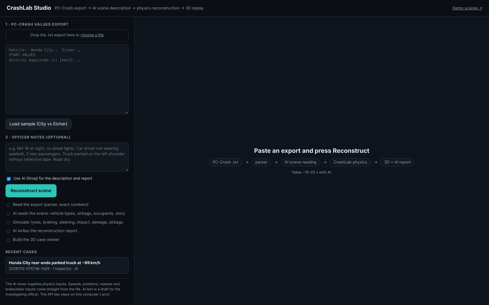
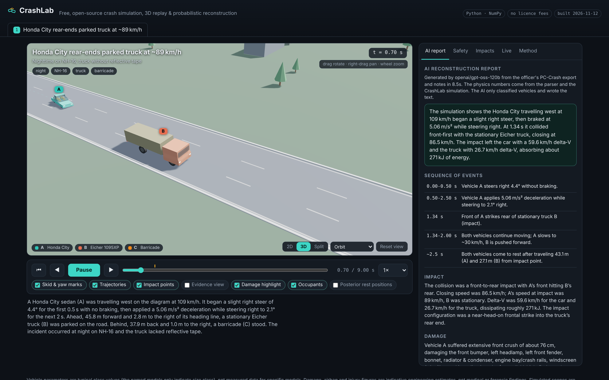
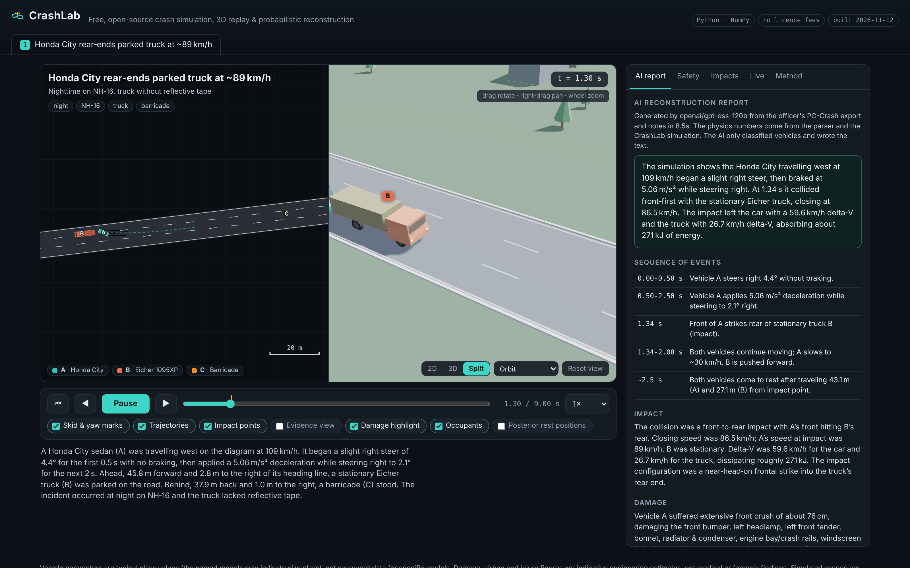
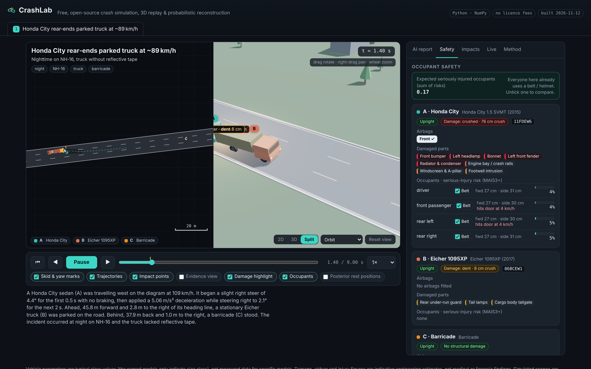

# CrashLab Studio (v3) — AI-assisted PC-Crash import pipeline

Takes a **real PC-Crash values export** (the text-file format PC-Crash produces for a crash
reconstruction) plus free-text officer notes, has an LLM read and classify the scene, runs the
exact same physics engine as [v2](https://github.com/rochitl72/crash-sim-v2) on the real
numbers, and hands back a 3D reconstruction with an AI-written investigator's report — as a
local web app, no cloud backend of ours involved.

```
PC-Crash .txt export  +  officer notes
        │
        ▼
   parser (crashlab/pccrash.py)  — exact numbers: speeds, positions, masses, brake/steer inputs
        │
        ▼
   AI scene interpretation (Groq)  — vehicle class, airbags fitted, occupants/belts, plain-English story
        │
        ▼
   CrashLab physics engine (v2)  — tyres, braking, steering, impact, damage, airbags, occupants
        │
        ▼
   AI reconstruction report (Groq)  — summary, impact, damage, occupants, consistency, next steps
        │
        ▼
   3D case viewer (same viewer as v2, + an "AI report" tab)
```

**The AI never supplies a physics input.** Every speed, position, mass, and brake/steer
instruction comes straight from the parsed file. The two Groq calls only (1) classify things the
file doesn't state — vehicle body style, likely airbags, occupant/belt assumptions — flagged as
assumptions, and (2) write up the *simulated* numbers in plain English for an investigator. This
separation is enforced in the prompts and double-checked in code (see "Guardrails" below).

## Screenshots

**Intake** — paste or drop the PC-Crash export, add officer notes, one button:


**Reconstructed case** — the real import, run through the v2 engine, in 3D:


**AI report tab** — summary, impact/damage narrative, consistency check against the file's own
end-values (when it has any), next steps for the investigation:


**Safety tab** — same occupant/airbag/injury model as v2, now populated from the real import:


## What's actually new here (vs. v2)

### 1. PC-Crash export parser (`crashlab/pccrash.py`)
PC-Crash's values export is a semi-structured text format: `Vehicle:` / `Database:` / `RecordID:`
headers, `START VALUES` / `END VALUES` / `INPUT VALUES` sections, and a `SEQUENCES` block of
numbered per-vehicle brake+steer instruction pairs (`maximum stopping time`, per-axle
`Brake force [%]`, `Specified brake acceleration`, `Steering time`, `New steering angle`).
`parse()` turns this into a structured dict per vehicle; `make_spec()` builds a real v2 `Spec`
from the INPUT VALUES (length/width/height/wheelbase/mass/CG/moments of inertia — falling back
to catalogue defaults for anything missing); `timeline()` turns the SEQUENCES into brake/steer
phases a driver closure can execute; `build_scene()` combines all of this plus the AI's
classification into a full v2 `Scene`, auto-framing the road around the actual vehicle positions.

### 2. AI scene interpretation (`crashlab/ai.py` — Groq, OpenAI-compatible API)
Two calls, both forced into JSON mode, both against `openai/gpt-oss-120b` (falls back to the
`-20b` variant on error):

- **`interpret()`** — given the parsed file plus pre-computed relative geometry ("vehicle B is
  12.4 m ahead of A and 1.1 m to its left"), classifies each vehicle's body style/likely
  airbags/occupants, and writes a 3–5 sentence scene description. It is explicitly instructed
  *not* to describe any collision or outcome — "a physics simulation will determine that" — so
  it can't accidentally invent an impact the simulator doesn't actually produce.
- **`report()`** — given the *simulated* result (impact speeds, ΔV, energy, damage, which
  vehicles were actually hit), writes the investigator-facing report. The prompt is given an
  explicit `not_struck` list (vehicles the simulation did **not** hit) and told that anything in
  it "must not be described as hit or contacted" — this was added after an earlier test run where
  the model described a barricade collision that never actually happened in the simulation.

If the Groq call fails or no key is set, `fallback_interpret()` classifies vehicles heuristically
(`guess_style()`) and the pipeline still runs end-to-end — the engine and the import work
without AI, you just lose the plain-English narration.

### 3. Deterministic consistency checks (`studio/pipeline.py` — `data_checks()`)
Independent of the AI: compares the simulated rest positions against the export's own END VALUES
when it has real ones (many sample exports have `END VALUES == START VALUES`, meaning there's
nothing to compare against — the pipeline says so explicitly rather than pretending otherwise),
cross-checks `total_weight` against `mass_empty + occupants + cargo`, and states the sequence-
reading convention and the road-geometry caveat (the road isn't in the export; a straight
carriageway is drawn for context only) up front.

### 4. Local web app (`studio/server.py`, stdlib `http.server`, no framework)
`POST /api/reconstruct` runs the whole pipeline under a lock, saves the generated case as a
standalone HTML file under `cases/`, and returns a small JSON summary. `GET /case/<id>` serves
that saved case. `GET /demo` serves the v2-style demo scenes. The server auto-scans ports
8765–8774 if the default is busy, and detects (and just opens) an already-running instance
instead of crashing with "address already in use".

### 5. Everything from v2, included directly (this repo is self-contained)
The full v2 engine — `vehicles.py`, `dynamics.py`, `collision.py`, `drivers.py`, `engine.py`,
`scenes.py`, `inverse.py`, `safety.py` — is vendored into `crashlab/` here too, so this repo
clones and runs on its own without needing v2 checked out separately. If you change the physics
engine, change it in both places (or symlink) to keep them in sync.

## Guardrails against AI hallucination

1. **Prompts are split by role.** `SYS_INTERPRET` only reads the input and is told not to predict
   outcomes. `SYS_REPORT` only reads the simulated output and is given the exact `not_struck` set.
2. **Validation on the AI's own output.** `_clean_interpret()` drops any vehicle index out of
   range, any `style` outside the fixed whitelist, and sanitizes free-text labels before they
   reach the simulator.
3. **The simulator is the source of truth for anything physical.** Speeds, positions, impact
   detection, ΔV, damage and airbag deployment all come from the deterministic v2 engine running
   on the parser's numbers — never from the AI.

## Clone and run

Requires Python 3.9+ and NumPy. A free Groq API key (get one at
[console.groq.com/keys](https://console.groq.com/keys)) if you want the AI steps; without one the
pipeline still runs using the deterministic fallback.

```bash
git clone https://github.com/rochitl72/crash-sim-v3.git
cd crash-sim-v3
pip install -r requirements.txt

cp .env.example .env
# edit .env and set GROQ_API_KEY=gsk_...   (or just leave it unset — AI steps fall back gracefully)

python3 build.py          # one-time: builds dist/data.json so the /demo route has data to serve
python3 studio/server.py  # starts the app, opens http://127.0.0.1:8765 automatically
```

In the browser: click **"Load sample (City vs Eicher)"** to try it with the included sample
PC-Crash export (`samples/pc_crash_sample_1.txt`), or paste/drop your own `.txt` export, add
officer notes if you have any, and press **Reconstruct scene**. Takes ~10–25 s with AI, a couple
of seconds without.

### Using it as a library, without the web UI

```python
from studio import pipeline
text = open("samples/pc_crash_sample_1.txt", encoding="latin-1").read()
base, pay = pipeline.run(text, notes="NH-16 at night, no street lights.", use_ai=True)
cid, path = pipeline.save_case(base, "cases")
print(pay["ai"]["report"]["summary"])
```

## Security note

The Groq key is read from a local `.env` file (never committed — see `.gitignore`) and is only
ever used server-side; it's never sent to the browser. `.env.example` is a template, not a real
key — `.env` itself must stay local to your machine.

## Project layout

```
crashlab/          the v2 physics engine, vendored in full (see v2's README for engine details)
  pccrash.py        PC-Crash values-export parser + Scene builder
  ai.py              Groq wrapper: interpret() and report(), JSON-mode, with a fallback path
studio/
  server.py          stdlib HTTP server: intake UI, /api/reconstruct, /case/<id>, /demo
  pipeline.py        parse -> AI interpret -> build_scene -> run_scene -> AI report -> save_case
  index.html         the intake page (drop zone, notes, progress steps, recent cases)
viewer/             same 2D/3D viewer as v2, plus an AI-report tab populated from pipeline output
vendor/             Three.js r149, vendored for offline use
samples/            a real anonymised PC-Crash values export to try the pipeline with
cases/              generated reconstruction case files land here (gitignored)
build.py            builds dist/data.json (needed by the /demo route and as a template base)
```

## Known limitations

- Depends on an external API (Groq) for the AI steps — if it's unreachable, you get the
  deterministic fallback (heuristic vehicle classification, no written narrative), not a crash.
- The road geometry is not present in a PC-Crash values export; a straight carriageway along the
  moving vehicle's heading is drawn for visual context only, not a reconstruction of the real road.
- Consistency checking against END VALUES only works when the export actually contains a result
  different from its START VALUES — many sample/template exports don't.
- One request at a time (the pipeline runs under a single lock) — this is a local single-officer
  tool, not a multi-user production service.

## License

MIT — see [LICENSE](LICENSE).
